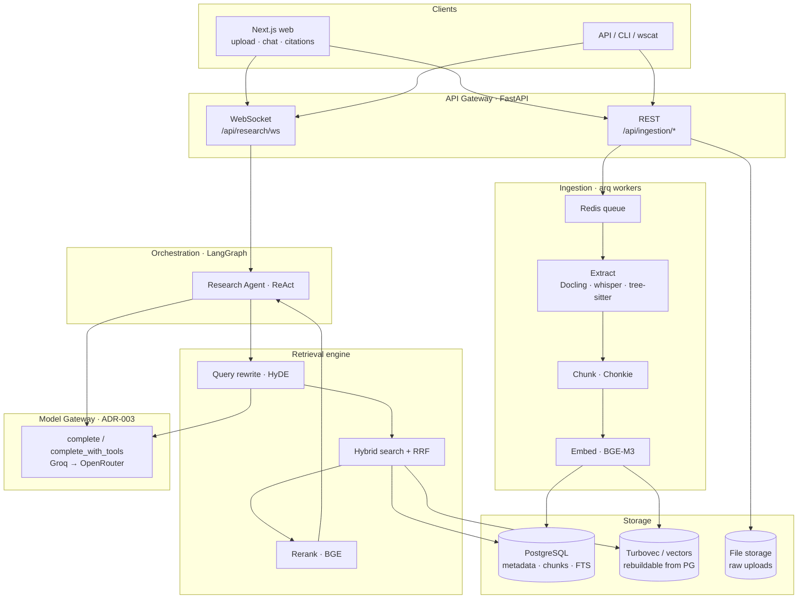
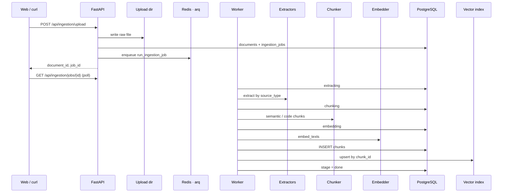
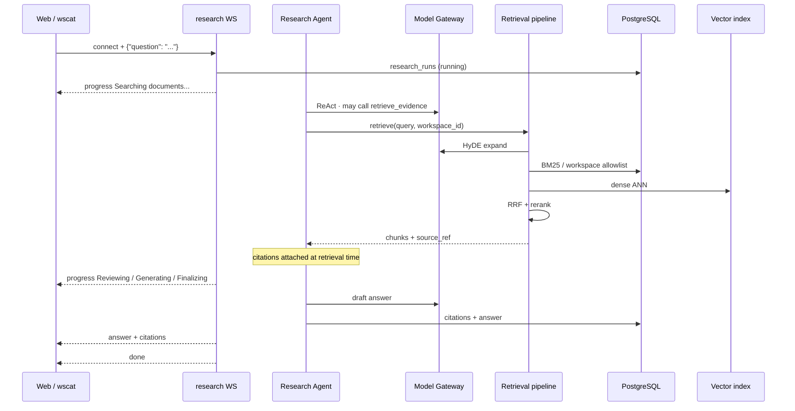
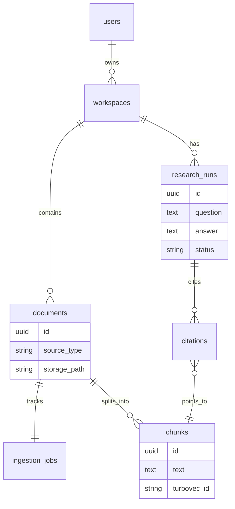

# Agentic Research Workspace

Enterprise **agentic RAG knowledge base**: upload your documents, ask questions, get **citation-backed** answers.

MVP scope is a single **Research Agent** (ReAct) over hybrid retrieval. The frozen V1 design also includes Planner, Critic, semantic cache, and MCP tools — see [`docs/PRD.md`](docs/PRD.md) and [`docs/latest-architecture.html`](docs/latest-architecture.html).

| Layer | What it does |
| --- | --- |
| **Knowledge base** | PDF / repo / audio → extract → chunk → embed → Postgres + vectors |
| **RAG** | HyDE → dense + BM25 hybrid (RRF) → rerank → cite chunks |
| **Agentic** | LangGraph Research Agent: reason → retrieve → draft under an iteration cap |

## Monorepo layout

| Path | Role |
| --- | --- |
| `apps/api/` | FastAPI, LangGraph agent, arq ingestion workers (Python) |
| `apps/web/` | Next.js UI — upload, progress, Q&A |
| `apps/docs/` | Docs site (scaffold) |
| `packages/ui/` | Shared React components |
| `docs/` | PRD, ADRs, specs, architecture |

## High-level architecture

MVP path (solid). Deferred V1 pieces are dashed.



Interactive V1 diagram (Planner, Critic, cache, security zones): open [`docs/latest-architecture.html`](docs/latest-architecture.html) in a browser.

## Low-level: ingestion

Upload returns immediately; an arq worker makes the document searchable.



## Low-level: research (ask → cited answer)

One WebSocket connection per run. Progress uses the fixed vocabulary in [`docs/ux.md`](docs/ux.md). Answer is currently sent as a full blob (token streaming not implemented yet).



## Data model (conceptual)



Postgres is authoritative for chunk text and metadata. The vector index is keyed by `chunk_id` and can be rebuilt from Postgres (see ADR-002).

## API surface (MVP)

| Method | Path | Purpose |
| --- | --- | --- |
| `POST` | `/api/ingestion/upload` | Upload file, enqueue job |
| `GET` | `/api/ingestion/jobs/{id}` | Poll ingestion stage |
| `WS` | `/api/research/ws` | Question → progress → answer + citations |
| `GET` | `/api/research/runs/{id}` | Fetch a completed run |
| `GET` | `/health` | Liveness |

## Quick start

```bash
# JS monorepo
pnpm install

# API (from apps/api/)
uv sync
# configure apps/api/.env — DATABASE_URL, REDIS_URL, model keys
uv run alembic upgrade head
uv run python scripts/seed.py
uv run uvicorn app.main:app --reload --port 8000

# Worker (second terminal, apps/api/)
uv run arq app.workers.WorkerSettings

# Web (optional)
pnpm --filter web dev
```

Details: [`apps/api/SETUP.md`](apps/api/SETUP.md), [`docs/AGENTS.md`](docs/AGENTS.md).

## Docs map

| Doc | Role |
| --- | --- |
| [`docs/PRD.md`](docs/PRD.md) | MVP goals and non-goals |
| [`docs/latest-architecture.html`](docs/latest-architecture.html) | Full V1 interactive architecture |
| [`docs/REMAINING.md`](docs/REMAINING.md) | Remaining work checklist |
| [`docs/specs/`](docs/specs/) | Ingestion, retrieval, researcher contracts |
| [`docs/adr/`](docs/adr/) | LangGraph, Turbovec, Model Gateway |
| [`ROADMAP.md`](ROADMAP.md) | Get-it-testable steps + future plan |

## Tech stack

- **API:** Python 3.11+, FastAPI, LangGraph, arq, SQLAlchemy async  
- **Retrieval:** BGE-M3, hybrid RRF, BGE-Reranker, Turbovec (numpy fallback in dev)  
- **Models:** Model Gateway (Groq → OpenRouter)  
- **Web:** Next.js 16, React 19, pnpm + Turborepo  
- **Data:** PostgreSQL (Neon), Redis (Upstash / arq)
