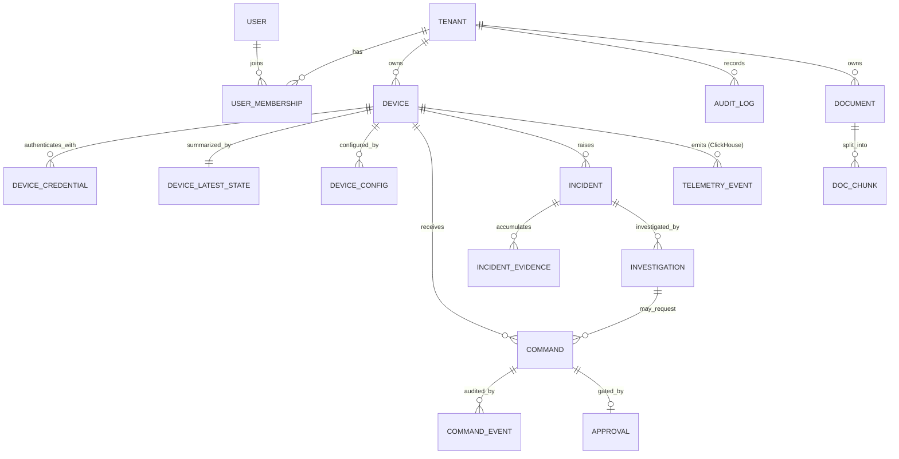

# DATA_MODEL

Devices, telemetry, incidents, commands and their relationships. Ownership rules are in [SERVICE_BOUNDARIES §4](SERVICE_BOUNDARIES.md#4-data-ownership). DDL below is a design sketch; the migrations in `migrations/` are the source of truth once they exist.

Conventions: UUIDv7 primary keys (time-ordered), `timestamptz` in UTC, every tenant-owned table has `tenant_id`, soft state changes are recorded in append-only event tables.

## 1. Entity relationships



## 2. PostgreSQL — schema `core` (Rust-owned)

```sql
create table core.tenant (
  id uuid primary key, name text not null, created_at timestamptz not null default now()
);

create table core.app_user (
  id uuid primary key, email citext unique not null,
  password_hash text not null, created_at timestamptz not null default now()
);

create table core.membership (
  tenant_id uuid references core.tenant, user_id uuid references core.app_user,
  role text not null check (role in ('owner','admin','operator','viewer')),
  primary key (tenant_id, user_id)
);

create table core.device (
  id uuid primary key,
  tenant_id uuid not null references core.tenant,
  external_id text not null,                       -- human-friendly, unique per tenant
  name text not null,
  kind text not null check (kind in ('real','simulated')),
  model text, fw_version text,                      -- model/hardware details provisional [HW-TBD]
  capabilities jsonb not null default '[]',         -- which command types it supports
  status text not null default 'offline' check (status in ('online','offline','disabled')),
  last_seen_at timestamptz,
  created_at timestamptz not null default now(),
  unique (tenant_id, external_id)
);

create table core.device_credential (
  id uuid primary key, device_id uuid not null references core.device,
  secret_hash text not null,                        -- argon2id; plaintext shown once
  valid_from timestamptz not null default now(),
  expires_at timestamptz, revoked_at timestamptz
);
-- up to two valid credentials per device => rotation overlap

create table core.device_latest_state (
  device_id uuid primary key references core.device,
  tenant_id uuid not null,
  boot_id uuid, last_seq bigint, last_event_ts timestamptz,
  telemetry jsonb not null,                         -- last accepted payload
  online boolean not null, updated_at timestamptz not null default now()
);

create table core.device_config (
  device_id uuid references core.device, version int,
  tenant_id uuid not null, config jsonb not null,
  status text not null check (status in ('pending','acked','rejected','superseded')),
  created_by uuid, created_at timestamptz default now(), acked_at timestamptz,
  primary key (device_id, version)
);

create table core.command (
  id uuid primary key,
  tenant_id uuid not null, device_id uuid not null references core.device,
  type text not null,                               -- from the command catalog
  params jsonb not null default '{}',
  risk text not null check (risk in ('risk_reducing','consequential')),
  status text not null check (status in
    ('pending_approval','approved','queued','sent','acked','executing',
     'completed','failed','rejected','expired','cancelled')),
  idempotency_key text not null,
  requested_by_kind text not null check (requested_by_kind in ('user','agent','rule','system')),
  requested_by_id text not null,
  incident_id uuid,                                  -- optional link
  target_boot_id uuid,                               -- reject if device rebooted
  expires_at timestamptz not null,
  created_at timestamptz not null default now(),
  unique (tenant_id, idempotency_key)
);

create table core.command_event (                     -- append-only
  id bigserial primary key, command_id uuid not null, tenant_id uuid not null,
  at timestamptz not null default now(),
  from_status text, to_status text not null, actor_kind text, actor_id text, detail jsonb
);

create table core.approval (
  command_id uuid primary key references core.command, tenant_id uuid not null,
  decision text not null check (decision in ('approved','rejected')),
  decided_by uuid not null references core.app_user, decided_at timestamptz not null default now(),
  note text
);

create table core.outbox (                            -- transactional outbox
  id bigserial primary key, tenant_id uuid not null,
  topic text not null, payload jsonb not null, command_id uuid,
  created_at timestamptz default now(), dispatched_at timestamptz, attempts int default 0
);

create table core.incident (
  id uuid primary key, tenant_id uuid not null, device_id uuid not null references core.device,
  rule_id text not null, dedupe_key text not null,
  severity text not null check (severity in ('info','low','medium','high','critical')),
  status text not null check (status in
    ('open','investigating','awaiting_approval','mitigating','resolved','closed')),
  title text not null, opened_at timestamptz not null, resolved_at timestamptz,
  unique (tenant_id, dedupe_key) deferrable
);

create table core.incident_evidence (                 -- append-only
  id bigserial primary key, incident_id uuid not null, tenant_id uuid not null,
  kind text not null check (kind in ('rule_hit','telemetry_window','tool_result','doc_citation','command_outcome','note')),
  payload jsonb not null, added_by text not null, at timestamptz default now()
);

create table core.dead_letter (
  id bigserial primary key, source text not null, topic text, device_id uuid,
  reason text not null, raw bytea not null, received_at timestamptz default now(),
  replayed_at timestamptz
);

create table core.audit_log (                         -- append-only
  id bigserial primary key, tenant_id uuid not null, at timestamptz default now(),
  actor_kind text not null, actor_id text not null, action text not null,
  target_type text, target_id text, detail jsonb, request_id text
);
```

### Indexes (starting set; verify with `EXPLAIN ANALYZE`)
- `device (tenant_id, status)`; `device (tenant_id, last_seen_at desc)`
- `command (device_id, status, expires_at)` partial where status in `('queued','sent')`
- `command (tenant_id, created_at desc)`
- `incident (tenant_id, status, severity)`; partial on open statuses
- `command_event (command_id, at)`; `audit_log (tenant_id, at desc)`; BRIN on `at` for large append-only tables
- `outbox (id) where dispatched_at is null`

### Row-level security
Every tenant table enables RLS with `tenant_id = current_setting('app.tenant_id')::uuid`. Each request transaction runs `SET LOCAL app.tenant_id = …`. The `hub-worker` background roles use an explicit, audited bypass role. See [SECURITY §4](SECURITY.md#4-tenant-isolation).

## 3. PostgreSQL — schema `agent` (Python-owned)

- `agent.run(id, tenant_id, incident_id, thread_id, status, started_at, finished_at, budget jsonb, usage jsonb, langfuse_trace_id)`
- LangGraph checkpointer tables (managed by the checkpointer library)
- `agent.run_event(id, run_id, seq, kind, payload, at)` — mirrors events sent to `hub-api`

## 4. PostgreSQL — schema `docs` (Python-owned, pgvector)

```sql
create table docs.document (
  id uuid primary key, tenant_id uuid,               -- null = shared/global manual
  title text, source_uri text, trust_level text not null default 'untrusted',
  content_hash text not null, ingested_at timestamptz default now()
);
create table docs.chunk (
  id uuid primary key, document_id uuid references docs.document, ordinal int,
  text text not null, tsv tsvector,                  -- BM25-style keyword side
  embedding vector(1536),                            -- dimension depends on chosen model
  embedding_model text not null, embedding_version int not null,
  metadata jsonb not null default '{}'               -- device model, section, fw range
);
-- indexes: hnsw on embedding, gin on tsv, btree on (document_id, ordinal)
```

`embedding_model` and `embedding_version` make re-indexing explicit. Retrieval always filters by tenant and device-model metadata.

## 5. ClickHouse — schema `telemetry`

```sql
create table telemetry.event_raw (
  tenant_id UUID, device_id UUID, boot_id UUID, seq UInt64,
  ts DateTime64(3, 'UTC'),                -- event time (bridge-corrected)
  ingested_at DateTime64(3, 'UTC'),
  schema_version UInt16,
  distance_cm Nullable(Float32),
  line_l UInt16, line_c UInt16, line_r UInt16,
  motion_state LowCardinality(String),
  left_pwm Int16, right_pwm Int16,
  battery_mv Nullable(UInt16),
  extra String                            -- JSON for forward-compatible fields
)
engine = ReplacingMergeTree(ingested_at)
partition by toYYYYMMDD(ts)
order by (tenant_id, device_id, toStartOfHour(ts), boot_id, seq)
ttl toDateTime(ts) + interval 30 day;     -- raw retention; tune after benchmarks

create materialized view telemetry.event_1m
engine = AggregatingMergeTree
partition by toYYYYMM(bucket) order by (tenant_id, device_id, bucket)
as select tenant_id, device_id, toStartOfMinute(ts) as bucket,
  minState(distance_cm) as dist_min, avgState(distance_cm) as dist_avg,
  maxState(distance_cm) as dist_max, countState() as n
from telemetry.event_raw group by tenant_id, device_id, bucket;
```

Design notes:
- The sorting key includes `boot_id, seq`, so `ReplacingMergeTree` collapses re-delivered events. Reads that must be exact use `LIMIT 1 BY (device_id, boot_id, seq)` rather than `FINAL`.
- Fleet-level analytics read `event_1m`, not raw rows.
- Simulated devices flow through the same tables, distinguished by `device.kind` in PostgreSQL.

## 6. What is *not* stored where

| Data | PostgreSQL | ClickHouse |
|---|---|---|
| Latest value per device | yes | no |
| Full history | no | yes |
| Commands, approvals, audit | yes | no |
| Incident evidence (summaries and references) | yes | no (windows referenced by `device_id` + time range) |
| Embeddings | yes (`docs.chunk`) | no |

## 7. Retention and growth

- Raw telemetry: 30 days *(initial)*; rollups: 13 months *(initial)*.
- Audit, commands, incidents: kept; partition by month when large.
- Dead letters: 14 days after replay or discard.
