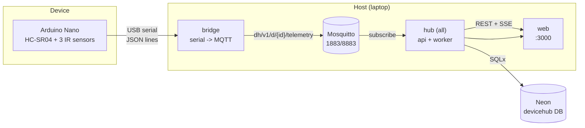

# PHASE 2 PLAN — Telemetry vertical slice

| | |
|---|---|
| Status | **In progress — T1–T6 implemented; T7–T11 pending** |
| Predecessor | Phase 1 / S0, recorded in [PHASE_1_REPORT](PHASE_1_REPORT.md) |
| Branch | `feat/devicehub-phase-2-telemetry` (cut from the Phase 1 branch) |
| Scope | Real Nano sensor data → bridge → MQTT → Rust ingest → PostgreSQL → live page |
| Explicitly not in scope | Motors, commands, approvals, incidents, agent, ClickHouse, simulator, config rollout |

## 0. Progress

| Ticket | State | Evidence |
|---|---|---|
| T1 | done | [ADR-0015](adr/0015-device-plane-dependencies.md); bridge switched to Rust |
| T2 | done | `crates/common` + `apps/hub` (`api`, `worker`, `all`); rustfmt, clippy `-D warnings`, tests green |
| T3 | done | `deploy/compose.dev.yaml`, Mosquitto config + ACL, password script, `.env.example` |
| T4 | done | `core` migrations, idempotent seed, migration test against a real Postgres |
| T5 | implemented, smoke-tested | ingest, dedupe, gap counting, dead letters, latest-state ordering, heartbeat sweep |
| T6 | implemented, smoke-tested | devices, detail, telemetry, stats, SSE with `Last-Event-ID` replay |
| T7 | bench smoke passed | `firmware/smoke` flashes and prints JSON at 115200; sensor firmware waits on the pin map |
| T8–T11 | pending | bridge, web page, Render deploy, bench demo |

### Verification run (2026-11-17, local Docker Postgres 16 + Mosquitto 2)

| Check | Result |
|---|---|
| Three valid frames (`seq` 1, 2, 4) | stored; `gaps` counter = 1 |
| Duplicate `seq` 2 | dropped; `duplicates` = 1; history still 3 rows |
| Malformed JSON | `core.dead_letter.reason = malformed_json` |
| Late `seq` 3 after `seq` 5 | stored in history; latest state stayed at 5 |
| SSE replay with `Last-Event-ID: 1` | replayed ids 2 and 3 |
| SSE live | delivered ids 5 and 6 |
| Auth | `/v1/*` 401 without token, 403 wrong token, 200 correct |
| 16 s silence | device `offline`, latest state `online = false` |
| Migrations run twice | second run a no-op; seed counts stay 1/1 |


## 1. Goal

Prove the device plane end to end with one real device and no motion:

> The Nano reports distance and line-sensor readings over USB. A bridge publishes them to MQTT. The Rust service validates, deduplicates, stores latest state and an append-only event log, and streams updates to a `/devicehub` page. Killing the device clearly shows it offline.

This is the smallest slice that exercises the real contracts. Every later capability (incidents, investigation, commands) depends on this path being correct, so it is built first and measured.

## 2. Locked decisions

| # | Decision | Rationale |
|---|---|---|
| D1 | Telemetry-only. No motors, no commands. | Motor hardware is unverified; motion adds risk without adding platform value. |
| D2 | Dedicated **new database on the existing Neon project**. | Isolated from the Knowledge Base database; no second container to run. |
| D3 | **Newline-delimited JSON** on the serial link. | Debuggable with any serial monitor; the documented MQTT JSON contract is unchanged. |
| D4 | One crate `apps/hub/` with `api`, `worker`, `all` binaries; Render runs `all`. | [ADR-0014](adr/0014-single-process-rust-deploy.md); free tier cannot run a background worker. |
| D5 | Persist `core.device_latest_state` **and** `core.telemetry_event`. | Gives charts and future incident windows; resolves contract finding C5 for the demo. |
| D6 | Minimal read-only `/devicehub` page in this phase. | Proves the read path and gives the demo a screen. |

## 3. Existing deployment (already live)

The Knowledge Base is deployed and must keep working untouched.

| Part | Where | Notes |
|---|---|---|
| Backend | Render free Docker web service `agentic-research-api` (`apps/api/render.yaml`) | One container runs `alembic upgrade head`, the arq worker, and uvicorn on `$PORT`; health check `/health` |
| Frontend | Vercel (Next.js) | Reads `NEXT_PUBLIC_API_BASE_URL`, inlined at build time |
| Database | Neon Postgres, `public` schema, pgvector | Alembic owns the schema |
| Redis | Upstash | Rate limiting and cache |
| Storage | Backblaze B2 (S3-compatible) | Uploads |
| Models | Model gateway: Groq → OpenRouter; Cohere embed/rerank | ADR-003 |
| Observability | Logfire | |

Precedent worth noting: the backend **already** runs the API and the arq worker in one free-tier container. ADR-0014 extends an existing pattern rather than inventing one.

## 3.1 Constraints the live deployment imposes

Render free tier: 512 MB RAM, 0.1 CPU, **750 instance hours/month per account**, no persistent disk, no background workers, HTTP(S) inbound only, spin-down after inactivity, ~30–60 s cold start.

| Mode | Where it runs | Broker | Purpose |
|---|---|---|---|
| **Local (live device)** | Laptop: Mosquitto, bridge, `hub` (api+worker), web | Mosquitto in Docker | The real Nano demo |
| **Hosted (portfolio)** | `hub` in `all` mode on a **second Render free service**; web stays on Vercel | **undecided** — see O1 | Public URL; seeded or simulator-fed data |

Consequences:

- The 750-hour budget is **account-wide**, shared with the live Knowledge Base service. Two always-warm services do not both fit a month; the hub service must sleep outside demos, or the live demo stays laptop-local.
- A free Render web service **cannot host Mosquitto**. Hosted live data needs an internet-reachable broker (O1). Until then the hosted instance is seeded, not live.
- The live device demo is laptop-local because the bridge owns the USB port.
- `hub` binds `0.0.0.0:$PORT`, uses a current-thread Tokio runtime, and keeps the SQLx pool at ≤ 5 connections.
- Cold start is accepted; no keep-warm job, consistent with the existing service.
- The web app already lives on Vercel. DeviceHub pages ship as new routes in that same app and call the hub **cross-origin**, so the hub needs the Vercel origin in its own `CORS_ORIGINS`.

## 4. Architecture



## 5. Data model delta — schema `core`

Additive, new database only. No relation to `public` tables. Single tenant seeded; `tenant_id` present from day one so multi-tenancy is not a later migration.

| Table | Columns (essential) | Notes |
|---|---|---|
| `core.tenant` | `id`, `name`, `created_at` | One seeded row |
| `core.device` | `id`, `tenant_id`, `external_id`, `name`, `kind`, `model`, `fw_version`, `status`, `last_seen_at`, `created_at` | `kind` includes `real` and `simulated` now, even though only `real` is used |
| `core.device_latest_state` | `device_id`, `tenant_id`, `boot_id`, `last_seq`, `last_event_ts`, `telemetry jsonb`, `online`, `updated_at` | One row per device |
| `core.telemetry_event` | `id`, `tenant_id`, `device_id`, `boot_id`, `seq`, `ts`, `ingested_at`, `schema_version`, `fw_version`, `distance_cm`, `line_l/c/r`, `motion_state`, `left_pwm`, `right_pwm`, `battery_mv`, `config_version`, `clock_skew`, `payload jsonb` | Append-only; `unique (device_id, boot_id, seq)`; `payload` keeps the accepted envelope for replay and later evidence |
| `core.dead_letter` | `id`, `source`, `topic`, `device_id`, `reason`, `raw bytea`, `received_at` | Invalid, oversize, wrong identity, unsupported version |

Indexes: `telemetry_event (device_id, ts desc)`, unique `(device_id, boot_id, seq)`, `device (tenant_id, status)`.

Deferred from `DATA_MODEL.md`: `device_credential` rotation and broker sync (Phase 5), `command`, `approval`, `outbox`, `incident*`, `audit_log`, `app_user`, `membership`. Phase 2 uses a static broker password file. **Deviation recorded:** credential lifecycle is not implemented yet.

Retention: at 5 Hz one device writes 432,000 rows/day (~130 MB with indexes). Neon's free tier stores 0.5 GB, so indefinite retention is not viable. Phase 2 keeps **48 hours** of events with an index-backed sweep (or a scheduled delete), while `device_latest_state` stays current. If 48 h is too much, ingest at 1 Hz or persist on change. Revisit before any load test.

Budget note: DeviceHub queries keep the Neon compute awake and draw on the same monthly budget as the Knowledge Base. A separate Neon project isolates the two (O6).

Rule: latest state updates only when the event is newer. Same `boot_id`: compare `seq`. Different `boot_id`: compare `ts`. Ties and older events still go to `telemetry_event`, never to latest state.

## 6. Wire contracts

### 6.1 Serial frame (Nano → bridge)

One JSON object per line, UTF-8, `\n` terminated, ≤ 200 bytes, 115200 baud, 5 Hz default.

```json
{"v":1,"seq":18422,"ms":921440,"dist_cm":23.4,"line":[120,860,130],"batt_mv":7400}
```

| Field | Type | Rule |
|---|---|---|
| `v` | int | Serial protocol version; `1` |
| `seq` | uint32 | Monotonic per boot, starts at 1 |
| `ms` | uint32 | `millis()` since MCU boot |
| `dist_cm` | float \| null | `null` when the echo times out |
| `line` | int[3] | Raw left/centre/right; `0–1023` if analog, `0/1` if digital (O3) |
| `batt_mv` | int \| absent | Only if a divider is wired |

Pins are `[HW-TBD]` in a `config.h` with placeholder defaults; they must be confirmed against the physical wiring before flashing.

Bench note (2026-11-17): the Uno's `println` emits `\r\n`. Firmware will write `\n` explicitly, and the bridge trims a trailing `\r` so a `println`-based sketch still parses. `firmware/smoke` confirms the 115200 JSON-line path.

### 6.2 Bridge mapping (serial → MQTT)

| Serial | MQTT v1 telemetry |
|---|---|
| `v` | `schema_version` |
| `seq` | `seq` |
| `ms` | `ts_mono_ms` |
| `dist_cm` | `distance_cm` |
| `line[0..2]` | `line.l / line.c / line.r` |
| `batt_mv` | `power.battery_mv` |
| — | `device_id`, `boot_id` (new UUID per bridge start), `ts` (RFC 3339 UTC), `fw_version`, `motion.state = "idle"` |

Topics: `dh/v1/d/{device_id}/telemetry` (QoS 1, not retained) and `dh/v1/d/{device_id}/status` (retained, with Last Will `offline`). Shared subscription is optional at one device.

### 6.3 HTTP API (Rust)

| Method | Path | Purpose |
|---|---|---|
| GET | `/v1/devices` | List with latest state and online flag |
| GET | `/v1/devices/{id}` | Device + latest state |
| GET | `/v1/devices/{id}/telemetry?limit=200&from=&to=` | Newest-first events, bounded limit |
| GET | `/v1/stream?topics=device:{id}` | SSE `device.state`, with `Last-Event-ID` replay and a 15 s keepalive |
| GET | `/v1/stats` | In-process counters: accepted, duplicates, gaps, dead letters |
| GET | `/healthz`, `/readyz` | Liveness, and DB + broker readiness |

Auth for the demo: `Authorization: Bearer $HUB_API_TOKEN` on `/v1/*`. This is explicitly **demo-only** and is not the `SECURITY.md` user-auth design; record it as such.

SSE notes: send a `: keepalive` comment every 15 s, because Render's proxy drops idle connections, and support `Last-Event-ID` so the browser resumes without a gap. The existing research stream is a short-lived POST, so this is new behaviour rather than a pattern copied from it.

### 6.4 Web

`apps/web/app/devicehub/page.tsx` (fleet list) and `apps/web/app/devicehub/devices/[id]/page.tsx` (latest state + a small chart + event table). Feature code in `apps/web/features/devicehub/`. Server components use `HUB_API_URL`; the SSE hook uses `NEXT_PUBLIC_HUB_API_URL`. No database, MQTT, or agent access from the browser.

`NEXT_PUBLIC_HUB_API_URL` must be referenced as a string literal, following the existing rule documented in `apps/web/lib/env.ts` (Next.js inlines `NEXT_PUBLIC_*` at build time), and must be set in Vercel **before** the build.

## 7. Work breakdown

Tickets are ordered by blocking edge. There is no configured issue tracker, so this table is the source of truth until you want them copied to GitHub Issues.

| ID | Ticket | Size | Depends on | Outcome |
|---|---|---|---|---|
| T1 | Dependency ADRs | S | — | ADR-0015 lists every new crate/package with justification (AGENTS.md rule 6) |
| T2 | Rust workspace skeleton | M | T1 | `crates/common`, `apps/hub` with `api`/`worker`/`all` bins; builds and runs |
| T3 | Dev broker + env | S | T2 | Mosquitto compose file, password file, `.env.example` for DeviceHub vars |
| T4 | `core` migrations + seed | M | T2 | SQLx migrations, tenant + device seed, `sqlx::migrate!()` on boot |
| T5 | Ingest worker | L | T3, T4 | Validate → dedupe → latest state → events → dead letter, with counters |
| T6 | Read API + SSE | M | T4 | The four `/v1` endpoints plus health checks |
| T7 | Nano firmware | M | hardware bench | JSON-line sensor telemetry, no motor code, `config.h` pins |
| T8 | Bridge | M | T3, T5, T7 | `apps/bridge/` **Rust** bridge (`serialport` + `rumqttc`): serial → MQTT, reconnect, ring buffer |
| T9 | `/devicehub` page | M | T6 | Fleet list, device detail, SSE updates |
| T10 | Render deployment | S | T5, T6 | `all` binary on Render free, migrations on boot, env documented |
| T11 | Bench bring-up + demo script | S | T7, T8, T9 | Recorded evidence and a repeatable 5-minute demo |

### Acceptance criteria

- **T1** — ADR-0015 accepted; every new dependency named with an alternative considered. No dependency appears in code before the ADR.
- **T2** — `cargo build`, `cargo fmt --check`, `cargo clippy -D warnings`, `cargo test` pass; `api` and `worker` run separately and `all` runs both in one process.
- **T3** — `docker compose -f deploy/compose.dev.yaml up mosquitto` starts; a `mosquitto_pub`/`sub` round trip with the device user succeeds; no secret committed.
- **T4** — `sqlx migrate run` on an empty database creates `core`; a second run is a no-op; seed is idempotent.
- **T5** — Unit tests cover: valid event, duplicate key, older `seq`, cross-boot ordering, clock skew, malformed JSON, oversize payload, identity mismatch, unsupported version. Duplicates do not create a second `telemetry_event` and do not regress latest state.
- **T6** — Endpoints return documented shapes; SSE emits `device.state` within 1 s of ingest locally; unknown device returns 404; limit is bounded.
- **T7** — Serial output parses as one object per line for 10 minutes without a malformed line; `dist_cm` tracks a moving hand; each line channel changes on tape vs floor.
- **T8** — Killing and restarting the broker does not crash the bridge; buffered events replay with original `seq`; duplicate publish is harmless; the crate builds with `libudev-dev` installed.
- **T9** — Fleet list shows online/offline; detail page updates without reload; `pnpm --filter web lint` and `check-types` pass.
- **T10** — Hosted `/healthz` returns 200; migrations applied on boot; `readyz` reflects DB and broker state; the Vercel origin appears in the hub's CORS list; the account stays inside 750 instance hours; cold start documented.
- **T11** — Demo script runs end to end in under 5 minutes, including a deliberate disconnect showing offline.

## 8. Test strategy

| Layer | Approach |
|---|---|
| Rust units | Pure functions for validation, ordering, and dedupe decisions; no broker or DB needed |
| Rust integration | `#[sqlx::test]` against a CI Postgres service container; MQTT handled by calling the message handler with raw bytes |
| Broker smoke | Manual `mosquitto_pub`/`sub` check in T3 and T11; not required in CI |
| Web | Existing `lint` + `check-types`; no new test framework this phase |
| Regression | `uv run pytest` must remain **311 passed, 1 skipped**; `pnpm check-types` green |

No `testcontainers` dependency: it would need its own ADR and buys little at this size.

## 9. Risks

| Risk | Impact | Mitigation |
|---|---|---|
| Nano clones with CH340 need a driver | Bridge cannot open the port | Verify enumeration before anything else (bench test 1) |
| HC-SR04 `pulseIn` blocks the loop | Jittery telemetry | 30 ms timeout, 5 Hz default |
| Analog vs digital line sensors differ | Wrong `line` scale | O3 decided at bench time; contract unchanged |
| Render 0.1 CPU + spin-down | Slow first request, ingest jitter | Current-thread runtime, small pool, accepted cold start |
| Neon autosuspend | First query latency | Warm on `/readyz`; acceptable for demo |
| Laptop sleeps mid-demo | Telemetry stops | Demo script checks power settings |
| Contract finding C1 (seq collision) | Dedupe ambiguity later if `event` is added | Phase 2 uses telemetry only; resolve C1 before adding `event` |
| Render instance-hour budget shared with the live KB service | Hub throttled, or the KB stops serving | Hub sleeps outside demos; watch usage against 750 h; decide at O1 |
| Neon free storage and compute shared with the KB | DeviceHub writes exhaust the budget and slow the KB | 48 h retention, small pool, separate project (O6) |
| Long-lived SSE through Render's proxy | Stream silently drops mid-demo | 15 s keepalive, `Last-Event-ID` resume, reconnect tests in T11 |

## 10. Out of scope (explicit)

Commands, outbox, approvals, `estop`; deterministic rules and incidents; LangGraph investigation and agent tools; ClickHouse; simulator and fault injection; config versions; credential rotation and broker sync; RLS and multi-tenant tests; user authentication; Grafana/Prometheus; motor control and line following; any change to the Knowledge Base.

## 11. Definition of done

1. Real Nano readings appear on `/devicehub` in under 1 s locally, and the device shows offline within the heartbeat timeout after disconnect.
2. Duplicate, stale, malformed, and unknown-version messages are handled exactly as `EVENT_CONTRACTS.md` specifies, with counters and dead letters.
3. `cargo test`, `cargo clippy -D warnings`, `cargo fmt --check` pass.
4. `uv run pytest` is unchanged; `pnpm check-types` and per-app lint pass.
5. Hosted `/healthz` is green on Render free tier.
6. The demo script runs twice, from a clean database, without manual SQL.
7. The Knowledge Base still runs independently and no existing file was modified except additive CI/deploy entries.

## 12. Preservation impact

| Area | Change |
|---|---|
| `apps/api`, `apps/web` existing routes, `packages/*` | none; `apps/web/lib/env.ts` gains one additive export for `NEXT_PUBLIC_HUB_API_URL` |
| Vercel project | new environment variable only; existing build and domains unchanged |
| Existing Alembic chain / `public` schema | none |
| `.github/workflows/ci.yml` | additive Rust job only |
| `apps/api/render.yaml` | additive second service block, or a separate blueprint file |
| New root paths | `crates/`, `apps/hub/`, `apps/bridge/`, `deploy/`, `firmware/` |

## 13. Open decisions before implementation

| # | Decision | Recommendation |
|---|---|---|
| O1 | Internet-reachable broker for the hosted mode (EMQX Cloud serverless vs HiveMQ Cloud vs hosted mode is seeded only) | Defer: keep Phase 2 laptop-live, hosted instance seeded. Decide when the hosted live demo matters. |
| O2 | Nano pin assignment | You confirm from the physical wiring; sketch ships with clearly-marked placeholder pins |
| O3 | Line sensors analog or digital | Decide at bench test; analog preferred if the modules expose it |
| O4 | Demo API token handling | Single `HUB_API_TOKEN` in env, no user accounts this phase |
| O5 | Neon database name and pooled URL | `devicehub`, separate `DATABASE_URL` for the service |
| O6 | Same Neon project or a separate one | Separate project: isolates storage and compute-hour budgets from the live Knowledge Base |

Implementation was authorized on 2026-11-17; T1–T6 are in the tree. T7 (firmware) waits for confirmed pin mapping, and T9 needs the API frozen first.
