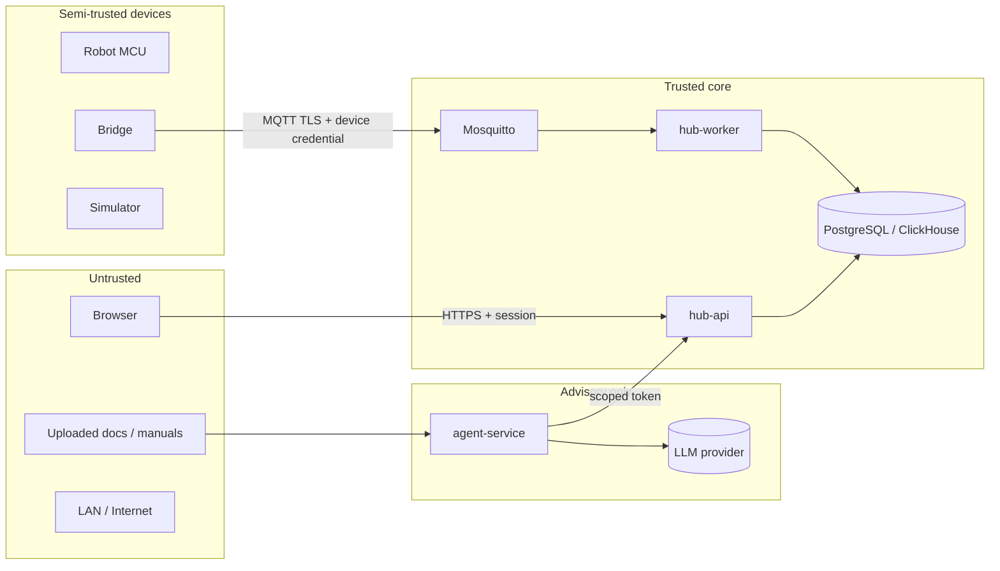

# SECURITY

Authentication, permissions, tenant isolation and device safety. This is a portfolio-grade design intended to follow production patterns; it is not a certified or audited system.

## 1. Trust boundaries

Treat as **untrusted input**: browser requests, device payloads, document content, tool outputs, and LLM output. Treat as **trusted decision makers**: `hub-api` policy gate and firmware limits.

## 2. Authentication

| Principal | Mechanism |
|---|---|
| **Users** | Email + password (argon2id) → short-lived access token (≈15 min) and rotating refresh token in an HttpOnly, Secure, SameSite cookie. External OIDC is a later option; the API depends only on a `Principal` abstraction. |
| **Devices** | MQTT over TLS; username `d_<device_id>`, password = per-device secret (≥ 128-bit random, argon2id-hashed server-side). Client certificates are the stronger option if hardware allows. |
| **Hub services → broker** | Separate service credentials with scoped ACLs |
| **`agent-service` → `hub-api`** | Per-run scoped JWT (see §6), short TTL, audience `hub-api` |
| **`hub-api` → `agent-service`** and **agent → internal events** | HMAC-signed requests with timestamp and nonce; secrets from environment/secret store |
| **Command integrity** | Per-device HMAC key signs `cmd` and `cfg`; verified by bridge/firmware |

Credential lifecycle:
- Secret shown once at creation; only hash stored.
- Rotation: create a second credential (overlap window, default 24 h), update the device, revoke the old one.
- Broker auth is synced from `core.device_credential` by `hub-worker` (password file regenerated and broker reloaded, [ADR-0003](adr/0003-mosquitto-broker.md)). Revocation takes effect within the sync interval and by forcing a disconnect.
- Failed-auth attempts are rate-limited and logged.

## 3. Device identity and command integrity

- Device identity = authenticated MQTT username. **Topic and payload `device_id` must match** the identity; mismatch is dropped and counted.
- Device ACLs permit only that device's own topics ([EVENT_CONTRACTS §2](EVENT_CONTRACTS.md#2-topics)).
- Commands are signed, expiring, bound to `boot_id`, and idempotent by `command_id`, which defeats replay of captured commands.
- Firmware keeps only a verification key; it cannot be used to mint commands.
- Physical access to the robot is out of scope for tamper resistance; the prototype assumes a controlled environment.

## 4. Tenant isolation

Defense in depth, so one bug does not leak across tenants ([ADR-0009](adr/0009-tenant-isolation-rls.md)):

1. **Identity-derived tenant.** Tenant comes from the authenticated principal or the device registry; never from request bodies, topics, or LLM output.
2. **PostgreSQL RLS** on every tenant table; each request transaction sets `app.tenant_id` via `SET LOCAL`. App role has no `BYPASSRLS`; background jobs use a separate, narrowly granted role.
3. **ClickHouse**: queries are built only through a tenant-scoped query builder that injects `tenant_id` predicates; a row policy per service user is the second line.
4. **Vector search**: retrieval always filters `tenant_id` (or global documents).
5. **Realtime**: SSE subscriptions are authorized per topic; a client cannot subscribe to another tenant's streams.
6. **Agent runs** are bound to one tenant and one incident; tokens carry both.
7. **Tests**: a cross-tenant test suite attempts reads/writes/streams across tenants on every endpoint and must fail closed; also run against simulated multi-tenant data in CI.

## 5. Authorization

### Roles
| Role | Capabilities |
|---|---|
| `viewer` | Read devices, telemetry, incidents, commands, audit |
| `operator` | viewer + create commands, approve/reject, acknowledge/close incidents, trigger investigations |
| `admin` | operator + register devices, rotate/revoke credentials, manage config, manage users |
| `owner` | admin + tenant settings |
| `agent` (service principal) | read-scoped tools; **request** commands; cannot approve, cannot manage credentials/config |
| `device` | MQTT only, own topics |

### Approval separation
- An approver must be a human with `operator` or higher.
- The requester may not be the approver for consequential commands when two eligible users exist (configurable; single-user demo mode logs a warning).
- The `agent` principal is rejected on the approve endpoint at the service layer, not just hidden in the UI.

### Rate limiting
Per-principal and per-IP limits on auth, command creation, and expensive queries; per-device publish rate limits at the worker (excess counted and dropped).

## 6. Agent safety

Principle: **the LLM advises; deterministic code decides.**

- **Narrow tools only.** `get_device_status`, `get_telemetry_window`, `list_incidents`, `search_docs`, `request_command`. No shell, no raw SQL, no HTTP fetch.
- **Per-run scoped token:** tenant, incident, allowed tools, expiry, max calls. Tool server-side checks repeat these.
- **Request, not execute.** `request_command` creates a command in the normal lifecycle; the policy gate and human approval apply identically.
- **Command allow-list.** The tool schema exposes only catalog types and valid ranges; the backend validates again.
- **Prompt injection.** Retrieved chunks and tool outputs are wrapped as data and never concatenated into instructions; documents carry a `trust_level`; instruction-like text in data is ignored. A regression corpus (poisoned manual passages, malicious device names/notes, crafted telemetry strings, unicode tricks) runs in CI and requires zero unsafe command requests.
- **Budgets.** Step, tool-call, time, and token caps per run; cost tracked per run in Langfuse.
- **Output validation.** Diagnosis must parse against its schema; citations must reference retrieved chunks.
- **Data minimization.** Only incident-relevant evidence is sent to the LLM provider; no credentials or secrets ever enter prompts; logs redact them.
- **Kill switch.** An admin setting disables agent command requests tenant-wide.

## 7. Device and physical safety

Layered, strongest at the bottom:

| Layer | Control |
|---|---|
| Backend | Catalog, param ranges, risk class, approval, re-validation, expiry, boot binding, audit |
| Bridge | Signature check, allow-list, expiry, rate limit |
| Firmware | Hard-coded max speed/duration, obstacle threshold floor, command re-validation, e-stop latch, comms-loss stop, watchdog reset |
| Hardware | Motor power switch/fuse; wheels-lifted bench testing for new firmware; physical e-stop (kill switch) within reach |

Safe-command policy:

| Class | Examples | Rule |
|---|---|---|
| Risk-reducing | `stop`, `estop`, `ping`, `request_diagnostics`, speed-limit decrease | May auto-approve; always accepted |
| Consequential | `resume_line_follow`, `reset_estop`, speed-limit increase | Human approval required; re-validated; device must be online and not obstructed |
| Forbidden | Raw PWM, pin writes, firmware limit changes, arbitrary code | Not representable in the catalog |

Test every safety behavior on hardware and record it: obstacle stop, `stop`, `estop`, comms loss, stale command, replayed command, power brown-out behavior.

## 8. Secrets and configuration

- No secrets in git. `.env.example` lists names only. Local dev uses `.env` (ignored); CI uses encrypted secrets. A secrets manager is the production path.
- Separate keys: JWT signing, HMAC for service calls, per-device command keys, DB roles, broker service accounts.
- Key rotation procedure documented; JWT supports `kid` for rotation.
- Dependency and image scanning (cargo-audit/deny, pip-audit, npm audit, container scan) and an SBOM in CI.

## 9. Transport and data protection

- TLS for browser (HTTPS) and broker (8883). Local dev may use a dev CA; plaintext broker port is bound to localhost only.
- Security headers and strict CORS on `hub-api`; CSRF protection on cookie-authenticated mutations.
- Input validation at every boundary; size limits on payloads and uploads.
- Document uploads: type allow-list, size cap, parsed in a sandboxed worker, stored with `trust_level`.
- Retention per [DATA_MODEL §7](DATA_MODEL.md#7-retention-and-growth); audit logs are append-only (revoked `UPDATE/DELETE` privileges).

## 10. Audit

Recorded with actor, target, request ID, and trace ID: logins, device registration, credential rotation/revocation, config changes, command create/approve/reject/send/ack/outcome, agent runs and tool calls, incident status changes, policy denials. Viewable in the dashboard; exported to logs.

## 11. Threat model (summary)

| # | Threat | Vector | Mitigations |
|---|---|---|---|
| T1 | Unauthorized motion | Forged or replayed command | Signed, expiring, boot-bound, idempotent commands; broker ACLs; bridge/firmware checks |
| T2 | LLM-induced unsafe action | Prompt injection, hallucination | Request-only tools, allow-list, human approval, re-validation, firmware limits, injection tests |
| T3 | Cross-tenant data access | Missing filter, IDOR | Identity-derived tenant, RLS, scoped query builder, cross-tenant tests |
| T4 | Device impersonation | Stolen credential | Per-device secrets, rotation/revocation, TLS, topic-identity match, optional client certs |
| T5 | Telemetry flooding / DoS | Compromised or buggy device | Per-device rate limits, bounded queues, shedding, payload size limits |
| T6 | Telemetry poisoning | Fake readings triggering actions | Rules produce incidents, not motion; consequential actions need human approval |
| T7 | Credential/secret leakage | Logs, prompts, repo | Redaction, no secrets in prompts/git, secret scanning |
| T8 | Data tampering | DB access, audit edits | Append-only audit, restricted roles, backups |
| T9 | Broker compromise | Network access | TLS, authentication required, command signatures independent of broker |
| T10 | Supply chain | Dependencies/images | Pinned versions, scans, SBOM |
| T11 | Physical hazard | Software bug during demo | MCU limits, comms-loss stop, physical kill switch, bench-test protocol |
| T12 | Replay of stale incidents/commands after outage | Reconnect storms | `expires_at`, `boot_id`, dedupe by `command_id` |

Out of scope: physical tampering with the robot, nation-state adversaries, side channels.

## 12. Security testing

- Cross-tenant suite (API, SSE, vector search, ClickHouse)
- Policy-gate unit tests for the full command/role/risk matrix
- Prompt-injection corpus in the agent eval suite
- Fuzzing of MQTT payload parsers and serial frame decoder
- Crash/restart tests: no duplicate command execution
- Dependency and container scanning in CI
