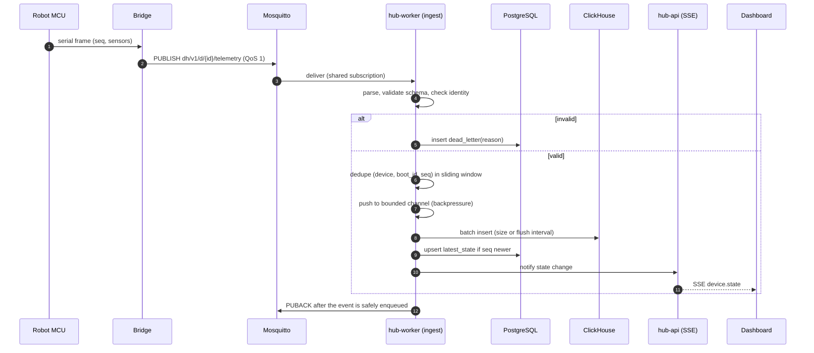
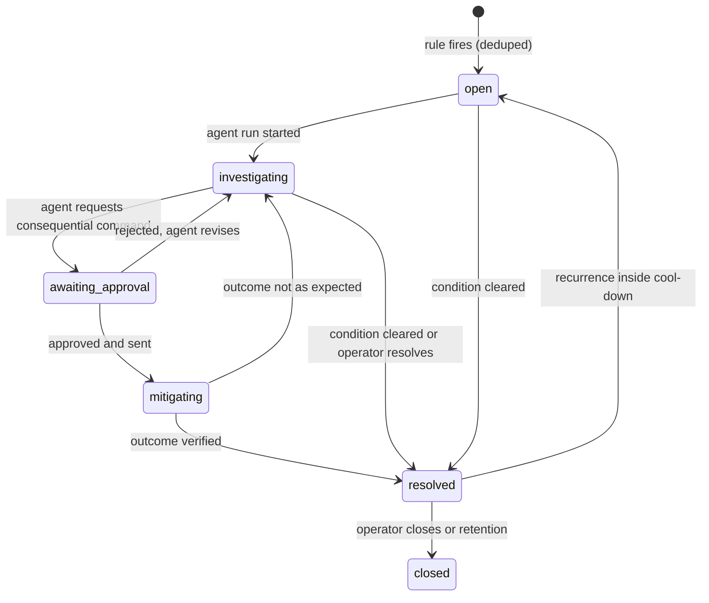
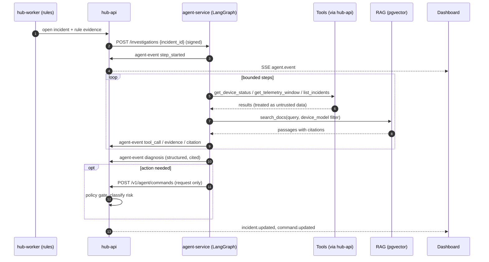
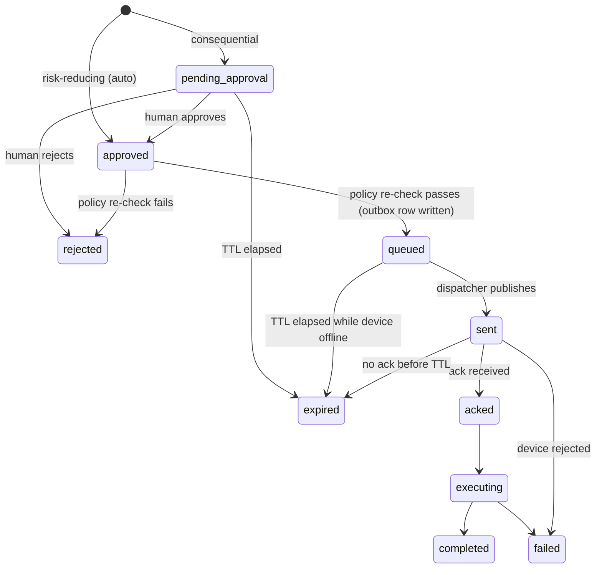
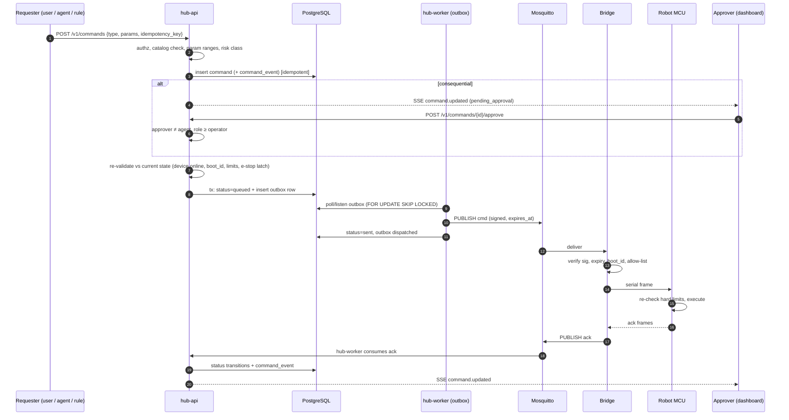

# WORKFLOWS

Telemetry ingestion, incident investigation and command approval, plus the supporting state machines. Contracts are in [EVENT_CONTRACTS](EVENT_CONTRACTS.md); tables in [DATA_MODEL](DATA_MODEL.md).

## 1. Telemetry ingestion

**Rules**
- **Acknowledge late, dedupe always.** The worker acknowledges the MQTT message only after it has been enqueued into a durable-enough stage (bounded channel then batch). Redelivery is expected; dedupe makes it harmless.
- **Bounded everything.** Per-stage channels have fixed capacity. When the batch writer lags, upstream stops reading from the broker (backpressure). If the broker queue itself overflows, the policy is **shed oldest telemetry first, never commands/acks**, with counters.
- **Batching.** Flush at *N* rows or *T* ms, whichever first; both configurable and benchmarked ([PRD §6](PRD.md#6-non-functional-requirements)).
- **Latest state** updates only when `(boot_id, seq)` is newer than stored; history is always kept.
- **Failures.** ClickHouse down: retry with exponential backoff and jitter; after the retry budget, spill batch to `dead_letter` (with replay tool) rather than block forever. PostgreSQL down: pause consumption; readiness fails; broker buffers within its limits.
- **Graceful shutdown.** Stop consuming, drain channels, flush batches, then exit.
- **Presence.** `status` messages plus a heartbeat timeout drive `online/offline`; transitions emit `device.presence` and may open `device_disconnected` incidents.

### Ingestion failure matrix

| Event | Handling | Observable via |
|---|---|---|
| Duplicate | Drop | `duplicates_total` |
| Out-of-order | Store history, skip latest | `out_of_order_total` |
| Malformed | Dead letter | `dead_letter_total{reason}` |
| Clock skew | Clamp `ts`, flag | `clock_skew_total` |
| Overload | Backpressure then shed | `queue_depth`, `shed_total` |
| Sink failure | Retry then spill | `sink_retries_total`, `spill_total` |

## 2. Incident detection and investigation

### 2.1 Incident state machine

Dedupe key = `(device, rule_id, window)`. Rules use **hysteresis and debounce** (e.g. obstacle must persist for *k* samples; clear only after *m* clean samples) to prevent flapping.

### 2.2 Investigation flow

**LangGraph shape (single agent)**
`load_incident → gather_evidence → retrieve_docs → hypothesize → (needs_more_evidence? loop) → diagnose → propose_action? → await_approval → verify_outcome → finalize`

- **State** is checkpointed in `agent.*` after every node, so a restart resumes the run.
- **Budgets:** max steps, max tool calls, wall-clock timeout, token cap; breach ends the run as `partial` with a deterministic summary.
- **Tool calls:** each has a timeout, bounded retries, result-size cap; a failed tool yields a recorded error and the graph continues or degrades.
- **Structured diagnosis:** `{summary, likely_causes[{cause, confidence, evidence_refs[]}], recommended_actions[], citations[]}`, validated against a schema; unsupported claims (no evidence/citation) are stripped or flagged by the citation checker.
- **Untrusted input handling:** document chunks and tool outputs are passed as quoted data, never as instructions; the system prompt states this, and tests inject adversarial text ([SECURITY §6](SECURITY.md#6-agent-safety)).
- **Degraded mode:** LLM unavailable → run returns evidence summary only, incident remains operable by humans.

## 3. Command approval and execution

### 3.1 Command state machine

### 3.2 Sequence

**Guarantees and how they are met**

| Guarantee | Mechanism |
|---|---|
| Created once | `unique(tenant_id, idempotency_key)`; repeat returns the existing command |
| Never lost | Command row and outbox row written in one transaction |
| Published at most once per dispatch attempt chain | `SKIP LOCKED` claim; `sent` set after publish; on ambiguity the device dedupes by `command_id` |
| Executed at most once | Device keeps recent `command_id`s; duplicates return the prior ack |
| Not executed late | `expires_at` checked by hub, bridge and firmware |
| Not executed against a rebooted device | `target_boot_id` check |
| Human in the loop | Consequential commands cannot reach `approved` without a recorded human approval; agent identity cannot call approve |
| Safe after approval | Re-validation at queue time, bridge allow-list, firmware limits |
| Offline devices | Commands stay `queued` until expiry; delivered on reconnect if still valid |
| Auditable | Every transition writes `command_event`; approvals in `approval` and `audit_log` |

### 3.3 Emergency stop

`stop`/`estop` are risk-reducing, bypass queue ordering (published immediately with highest priority), require only an authenticated operator or agent identity, and are always accepted by the policy gate. Independently, the MCU stops on obstacle and on loss of communication (heartbeat timeout), so stop does not depend on the network path.

### 3.4 Verification

After `completed`, a verification step reads telemetry for a short window (e.g. `motion.state` and distance trend) and appends `command_outcome` evidence to the incident. If the expected effect is not observed, the incident returns to `investigating`.

## 4. Configuration rollout

1. Admin creates `device_config` version *n* (`pending`).
2. Hub publishes retained `cfg`; the device applies and replies `cfg/ack`.
3. `applied` → `acked`; previous version `superseded`. `rejected` keeps the device on the old version and records the reason.
4. Telemetry carries `config_version` so drift is detectable.

## 5. Reconnect and recovery

| Scenario | Behavior |
|---|---|
| Bridge loses broker | Buffer telemetry in a ring buffer; robot continues safely; on reconnect send buffered events with original `seq`/`ts`; the stale-command rule prevents old commands from running |
| Robot loses bridge | MCU stops after comms timeout; resumes only on valid new command or operator action per policy |
| Broker restarts | Clients reconnect with backoff; retained `status` and `cfg` restored; QoS 1 redelivery deduped |
| `hub-worker` crash | In-flight batch may re-ingest after restart; dedupe makes it idempotent; outbox rows remain claimable |
| `agent-service` crash | Run resumes from checkpoint, or incident stays operable manually |
| PostgreSQL outage | Readiness fails, ingestion pauses, commands cannot be created; broker buffers within limits |
