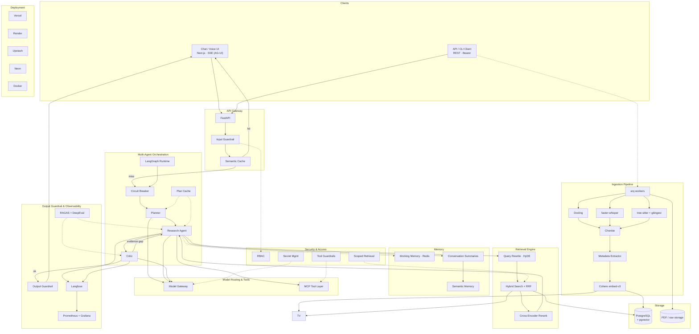
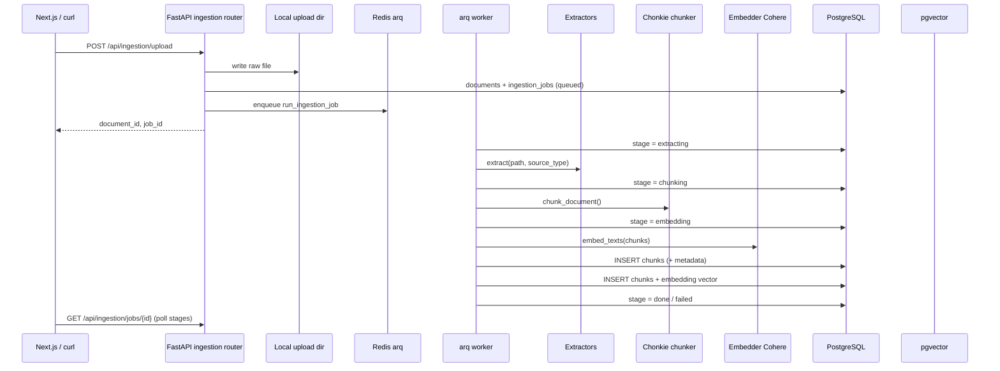
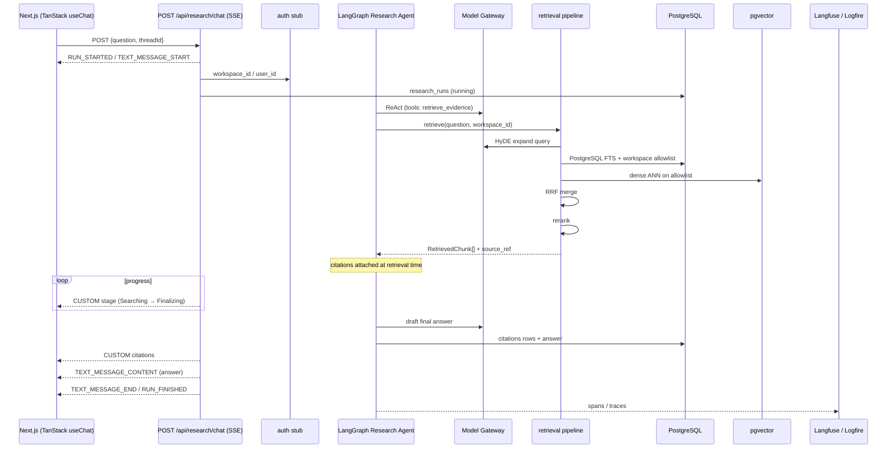
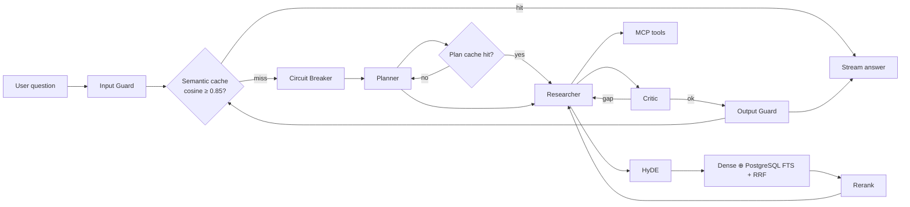

# Remaining Work — Agentic Research Workspace

> Snapshot of what is built vs what is left, derived from
> `docs/latest-architecture.html` (V1 design), `docs/PRD.md` (MVP boundary),
> `ROADMAP.md`, specs, and the current `apps/` code.
>
> Last updated: 2026-08-13

## Status legend

| Mark | Meaning |
|---|---|
| **Done** | Code exists and is wired |
| **Partial** | Scaffolded, but incomplete / fallback / not proven end-to-end |
| **Remaining** | Not built, or still needs operational verification |
| **Deferred** | Explicitly out of MVP (Phase 2+ per PRD Non-Goals) |

## How to read this document

- **MVP path:** upload → arq ingestion → Postgres + vectors → question over
  SSE (AG-UI) → Research Agent → hybrid retrieval → cited answer.
- **Not in MVP:** Planner, Critic, MCP tools, full security
  zone, nightly eval, multi-agent live trajectory UI.
- Rule from `AGENTS.md`: do not build deferred V1 features without a
  production signal and a spec under `docs/specs/`.

---

## Architecture zones vs implementation

| Zone | MVP target | Today |
|---|---|---|
| Clients | Minimal web | Partial Next.js UI |
| API Gateway | FastAPI REST + SSE (AG-UI) | Done (rate limits + `/healthz` + `/readyz` wired) |
| Retrieval | Hybrid + rerank | **Done** | Cohere embed/rerank; persisted `tsv` + GIN |
| Orchestration | 1 Research Agent | Done (no Planner / Critic) |
| Memory | — | Deferred |
| Storage | PG + vectors + FS | **Done** | pgvector on `chunks.embedding`; raw files in R2/local |
| Ingestion | arq 6-stage | Code done; E2E unproven |
| Model Gateway | Swappable | Done (Groq → OpenRouter) |
| MCP tools | — | Deferred |
| Observability | Langfuse traces | Wired; needs live config |
| Security | Auth stub | Stub only |
| Deploy | Local / managed | Neon + Upstash intended; no IaC |

---

## Suggested order

```text
1. DB: upgrade + seed + tsvector migration          ← **done** (GIN index applied)
2. Embed/rerank real endpoints (kill hash fallback) ← **done** (Cohere, no silent fallback in prod)
3. Worker + upload PDF E2E                          ← unblocks retrieval
4. retrieve() smoke + research agent + SSE          ← MVP success criteria (verified 2026-08-09)
5. Browser path via apps/web                        ← non-dev testing
6. Hardening (health, limits, retries)              ← **substantially complete** (2026-08-13)
7. Only then: Critic → Planner → cache → RBAC       ← V1 diagram features
```

---

## A. Clients

| Item | Status | Notes |
|---|---|---|
| Minimal Next.js chat + upload (`apps/web`) | Partial / Done | Upload, job poll, SSE Q&A (TanStack AI), citations UI exist |
| Live multi-agent trajectory UI | Deferred | `ux.md`: MVP shows stage names only |
| Voice UI | Remaining | Architecture shows “Chat / Voice”; not in MVP |
| API / CLI client polish | Partial | REST + SSE exist; no dedicated CLI package |
| `apps/docs` product docs site | Remaining | Still Turborepo starter template |
| Root `README` product docs | Remaining | Still generic Turborepo starter |

### Checklist

- [ ] Verify upload → poll → ask → cite E2E in the browser
- [ ] Error surfaces for SSE `RUN_ERROR` and failed ingestion
- [ ] Citation click → show source chunk passage
- [ ] Deploy Next.js (Vercel) when backend is stable

---

## B. API Gateway

| Item | Status | Notes |
|---|---|---|
| FastAPI factory, CORS, `/health` | Done | `app/main.py` |
| Ingestion + research routers mounted | Done | |
| Auth (JWT / multi-user) | Partial | `auth/stub.py` single-tenant only |
| Rate limiting | **Done** | Redis fixed-window; upload 5/min, chat 20/min per IP (`src/shared/rate_limit.py`) |
| Input Guardrail (LLM Guard) | Deferred | PRD Non-Goals |
| Semantic Cache Check (Redis vector) | **Done** (flag-off) | ADR-007; invalidation + hit-rate metrics shipped |
| Expanded `/health` (DB + Redis + embedding) | **Done** | `/healthz` (liveness) + `/readyz` (Redis ping + DB SELECT 1 + cached Cohere probe via `embedder.health_check()`) |

### Checklist

- [ ] Confirm migrations applied on Neon and seed user/workspace
- [x] Health checks for dependencies — Redis, DB, Cohere embeddings (60s-cached probe; dev-fallback aware)
- [ ] Tighten CORS / remove `/test-llm` for prod

---

## C. Retrieval Engine

| Item | Status | Notes |
|---|---|---|
| HyDE query rewrite | Done | Via Model Gateway |
| Hybrid dense + PostgreSQL FTS + RRF | **Done** | FTS uses the persisted `chunks.tsv` generated column + GIN index (migration `a1b2c3d4e5f6`), not `to_tsvector` on the fly |
| Workspace ID allowlist filter | Done | In hybrid search path |
| Vector search timeout | **Done** | `asyncio.wait_for(RETRIEVAL_VECTOR_SEARCH_TIMEOUT=5s)` in `src/retrieval/vector_index.py`; timeout → `RetrievalError` |
| Embed + rerank (Cohere) | **Done** | Cohere embed-v3 + rerank-v3 (commit `8411dfa`); `ALLOW_EMBEDDING_FALLBACK=false` default → provider failure fails the ingestion job loudly (`EmbeddingError`) instead of persisting hash/cosine fallback vectors |
| Dense vector store (pgvector) | **Done** | Embeddings persisted on `chunks.embedding` (pgvector); no in-memory fallback — the Postgres column IS the index |
| Rebuild index from Postgres on startup | Done | Lifespan in `main.py` (no-op — no rebuild needed) |

### Checklist (critical for real quality)

- [x] Migration: `chunks.tsv` + GIN (ROADMAP Step 4) — applied (`a1b2c3d4e5f6`, chain head `f2c8d4e6a9b1`)
- [x] Real embed + rerank endpoints — Cohere embed-v3 / rerank-v3 (commit `8411dfa`); silent fallbacks removed in production (`ALLOW_EMBEDDING_FALLBACK=false`)
- [x] Dense vector store — pgvector column, no in-memory fallback
- [ ] Integration proof: ranked results with real `source_ref` / `chunk_id` on a live DB

---

## D. Multi-agent orchestration

| Item | Status | Notes |
|---|---|---|
| LangGraph Research Agent (ReAct) | Done | `src/research/agent.py` |
| Citation-at-retrieval | Done | Spec + integration test scaffolding |
| Iteration bound (mini circuit breaker) | **Done** | `AGENT_RUN_TIMEOUT` (60 s) + `AGENT_ITERATION_TIMEOUT` (30 s) + evidence confidence gate |
| SSE (AG-UI) progress stages | Done | Must match `ux.md` vocabulary |
| Planner Agent | Deferred | Needs `docs/specs/planner.md` first |
| Critic + reflection loop | Deferred | Needs `docs/specs/critic.md` first |
| Plan Cache (APC) | Deferred | Depends on Planner |
| Full Circuit Breaker (cost, reflections) | Deferred | After Critic |

### Checklist (MVP ops)

- [x] Prove agent E2E: answer + ≥1 citation + `research_runs` / `citations` rows — verified 2026-08-09 (SSE, 8 citations persisted)
- [x] Prove SSE stage order and no CoT/prompt leakage — verified 2026-08-09
- [ ] Disconnect mid-run → `failed` status

---

## E. Model routing & tools

| Item | Status | Notes |
|---|---|---|
| Model Gateway abstraction | Done | ADR-003; `complete` / `complete_with_tools` |
| Provider chain | Partial | Groq → OpenRouter (not LiteLLM / Ollama as HTML labels) |
| LiteLLM multi-provider | Deferred | PRD + F8 |
| MCP Tool Layer (FS / GitHub / web) | Deferred | MVP tool = retrieval only |

### Checklist

- [ ] Keys in `.env` validated (`/test-llm` or gateway tests)
- [ ] Document actual stack vs architecture diagram (Groq/OpenRouter vs LiteLLM/Ollama)

---

## F. Memory

| Item | Status | Notes |
|---|---|---|
| Working Memory (Redis session trajectory) | Deferred | Redis used for arq only |
| Conversation Summaries | Deferred | `schema.md` deferred entity |
| Semantic Memory | Deferred | `schema.md` deferred entity |

Nothing required for single-shot MVP.

---

## G. Storage

| Item | Status | Notes |
|---|---|---|
| PostgreSQL ORM models | Done | users, workspaces, documents, jobs, chunks, runs, citations |
| Alembic migrations | **Done** | Chain head `f2c8d4e6a9b1`: content_hash, thread_id, tsvector + GIN, pgvector embedding column |
| Seed script | Done | `scripts/seed.py` |
| Local raw file storage | Done | `UPLOAD_DIR` pattern |
| Durable vector store | **Done** | pgvector on `chunks.embedding`; Postgres is the index — no separate vector store |

### Checklist

- [ ] `alembic upgrade head` on target DB
- [ ] Seed + FK integrity
- [ ] Confirm 7 tables + citations; add `tsv` migration
- [ ] Neon (prod) / local Postgres decision locked in env

---

## H. Ingestion pipeline

| Item | Status | Notes |
|---|---|---|
| Upload API + job status | Done | |
| arq worker entry | Done | `app/workers.py` / WorkerSettings |
| Docling / whisper / tree-sitter extractors | Partial | Wrappers present; heavy deps must be installed and tested per type |
| Chonkie semantic + code chunking | Done (code) | Needs real-file verification |
| Dedicated Metadata Extractor stage | Partial | Metadata fields on chunks; not a rich author/date/category service as in HTML |
| Embed + persist stages | Done (code) | Depends on embedder quality |
| Ingestion progress to client | Partial | Job poll stages; ensure UX strings match `ux.md` |
| Retry (3×) on transient failure | **Done** | `src/shared/retry.py` — exponential backoff + jitter, selective by exception type |
| File size / type validation | **Done** | PDF magic bytes, size, page count, encryption check in `src/ingestion/router.py`; client-side guard in `upload-composer.tsx` |

### Checklist

- [ ] PDF E2E &lt; 60s → `done` + non-zero chunks
- [ ] Repo zip / git URL path smoke
- [ ] Audio path smoke
- [ ] arq worker + Redis (`rediss://` Upstash) stable

---

## I. Output guardrail & observability

| Item | Status | Notes |
|---|---|---|
| Observability setup (Logfire + Langfuse wire-up) | Partial | `src/observability/setup.py`; needs tokens + real traces |
| Output Guardrail (Guardrails AI) | Deferred | PRD |
| RAGAS + DeepEval nightly | Deferred | F10 / needs golden set |
| Prometheus + Grafana | Deferred | F10 |

### Checklist (MVP-adjacent)

- [ ] Langfuse shows full run traces
- [ ] Logfire in cloud for shared env
- [ ] Optional: cost estimate on `ResearchRun` (F3)

---

## J. Security & access control

| Item | Status | Notes |
|---|---|---|
| Workspace-scoped retrieval filter | Partial | Query filter only; not hard multi-tenant RBAC |
| RBAC | Deferred | F9 |
| Scoped Retrieval as security boundary | Deferred | F9 |
| Secret management (Vault) | Partial | Env-based only |
| Tool Guardrails | Deferred | No MCP tools yet |

---

## K. Deployment & runtime

| Item | Status | Notes |
|---|---|---|
| Local monorepo (pnpm + uv) | Done | Scaffold |
| Docker-compose for PG/Redis | Skipped by design | ROADMAP: use Neon + Upstash |
| Vercel frontend | Remaining | |
| Render API + workers | Remaining | |
| Docker images for heavy ingestion models | Remaining | |
| Embedding endpoints via Model Gateway | Remaining | ROADMAP Step 7 |

---

## L. Core pipeline ops (get it testable)

Highest priority. Code is largely written; ops and proof are not.

| Step | Status |
|---|---|
| 1. Fix import paths / worker location | Done (codebase uses `app.*` / `src.*`) |
| 2. Config files (`alembic.ini`, pyright) | Mostly done — confirm alembic CLI |
| 3. Services (Neon + Redis URLs in `.env`) | Remaining to verify |
| 4. Migration + **tsvector** | Partial — tables yes, tsv no |
| 5. Seed | Script exists — run not verified |
| 6. Model gateway smoke | Remaining to verify |
| 7. Embeddings & rerank | Remaining |
| 8. Ingestion E2E | Remaining |
| 9. Retrieval script/tests | Remaining |
| 10. Research agent E2E | Remaining |
| 11. SSE (AG-UI) contract | Done — verified 2026-08-09 |
| 12. ruff + basedpyright + pytest green | Remaining to verify |

### Definition of Done (still open)

- [ ] PDF upload → `done` without manual steps
- [x] Question → cited answer over SSE — verified 2026-08-09
- [ ] ≥1 citation with usable `source_ref`
- [ ] Progress events use only `ux.md` strings
- [ ] Lint + typecheck clean

---

## M. Phase 2+ (architecture HTML, explicitly deferred)

Do not build without a metric / PRD justification (`AGENTS.md`).

- [ ] **F4** Critic + reflection (requires `docs/specs/critic.md`)
- [ ] **F5** Planner + plan cache (requires `docs/specs/planner.md`)
- [x] **F6** Semantic cache (ADR-007 — built behind `SEMANTIC_CACHE_ENABLED`, default off; see `docs/specs/semantic-cache.md`)
- [ ] **F7** Working / semantic / conversation memory
- [ ] **F8** LiteLLM multi-provider
- [ ] **F9** Real auth + RBAC + guardrails
- [ ] **F10** Golden-set eval + Prometheus / Grafana
- [ ] Full circuit breaker (cost + reflection caps)
- [ ] MCP tools (filesystem, GitHub, web search)

---

## High-level architecture (V1)

Ten zones from `docs/latest-architecture.html`. MVP ships a thin vertical
slice: Clients → Gateway → Retrieval → single Research Agent → Storage +
Ingestion.



---

## Low-level: ingestion



---

## Low-level: research run (MVP)



---

## Low-level: V1 multi-agent (not built yet)



---

## Related docs

| Doc | Role |
|---|---|
| `docs/latest-architecture.html` | Interactive V1 architecture (source of truth for design) |
| `docs/PRD.md` | MVP scope and Non-Goals |
| `ROADMAP.md` | Step-by-step “get it testable” plan + Future Plan |
| `docs/schema.md` | Conceptual data model + deferred entities |
| `docs/specs/*` | Component contracts (ingestion, retrieval, researcher) |
| `docs/ux.md` | Client progress vocabulary and citation display rules |
| `docs/adr/*` | Locked tech decisions (LangGraph, pgvector, Model Gateway) |

---

## Bottom line

Scaffolding covers most of the **MVP slice** of the architecture (ingest →
hybrid retrieve → single ReAct researcher → citations + thin web UI).

What remains is less greenfield modules and more:

1. **Make the core pipeline real** — DB/tsv, real embeddings, E2E proofs, remove silent fallbacks
2. **Productize** — frontend polish, hardening, deploy
3. **Unlock V1 multi-agent / cache / security / eval** only when usage justifies them
